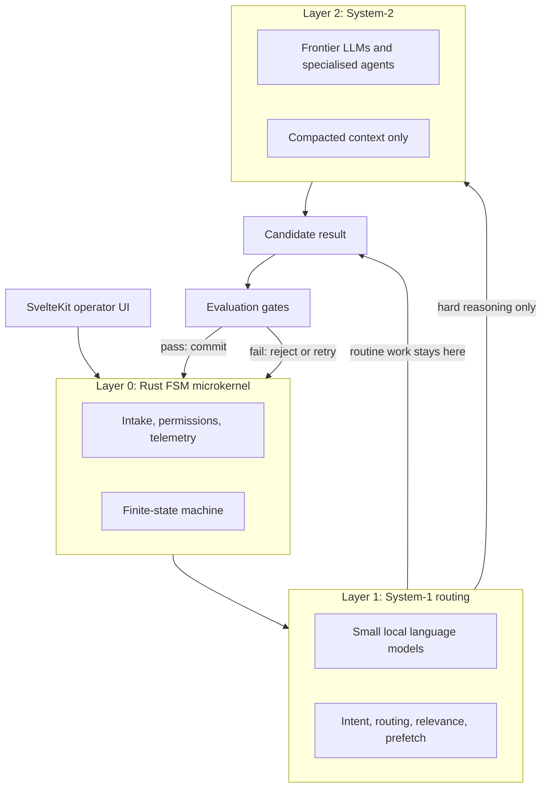
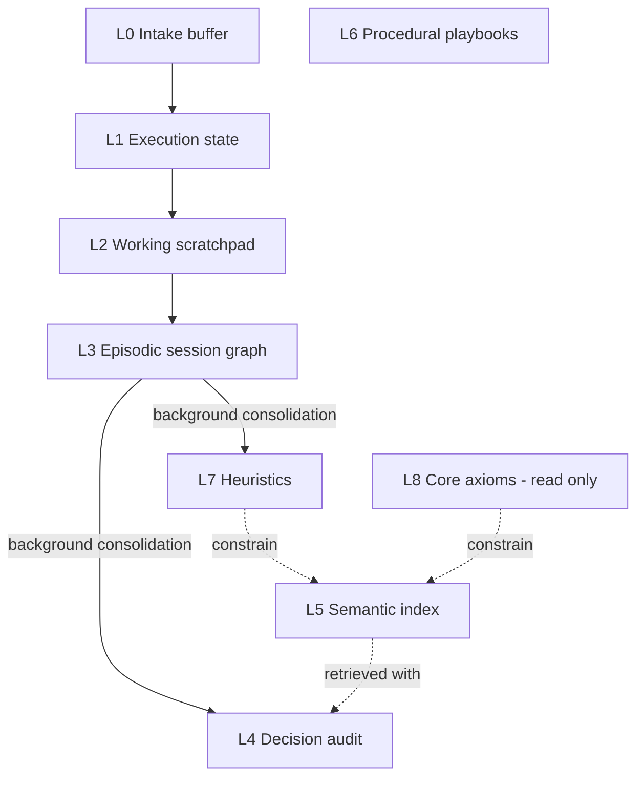
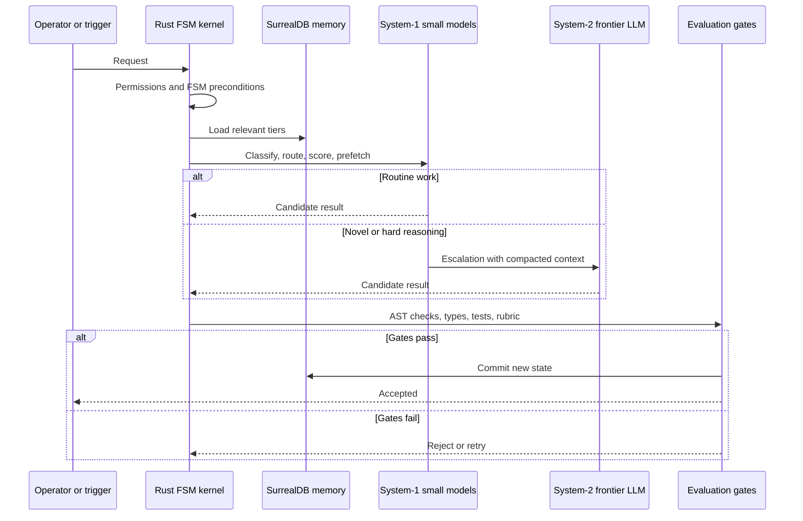

# Nexus Architecture

Documentation and diagrams for **Nexus**, an autonomous AI software factory. This repository is an architecture overview only. It contains no application source.

**Status:** In active development. Target completion: December 2026. The implementation is proprietary and the source is private.

Nexus is built around a simple bet: language models should not be the control plane. A deterministic kernel decides what is allowed to happen. Small local models handle routine routing. Frontier models are called only when the work needs hard reasoning. Memory is stored in typed tiers, not dumped back into a growing prompt.

## The problem

Two failure modes show up in most agentic systems.

1. **The model becomes the router.** A frontier LLM is asked to classify intent, pick a tool, score relevance and then do the actual thinking. That makes routine work expensive and slow, and it makes control flow hard to inspect.
2. **Context is stateless or loosely retrieved.** Session history is either forgotten between turns or stuffed into a prompt through generic RAG, which drifts and cannot explain why a past decision was made.

Nexus splits those jobs. Execution control is a finite-state machine in Rust. Routing is a small-model problem. Memory is a multi-tier store on SurrealDB, with graph, vector and document access over the same data.

## Three-layer execution stack

**Layer 0 is the kernel.** Written in Rust (Tokio) as a finite-state machine. It owns intake, permission checks, execution boundaries and telemetry. An agent cannot advance a software-development stage, or run a destructive action, unless the FSM preconditions for that transition are met. Model output is not allowed to move the system forward on its own.

**Layer 1 is System-1.** Small local language models, plus lightweight embeddings, handle the fast path: intent classification, routing, relevance scoring and prefetch. This is ordinary, high-frequency work, so it stays on small models. Frontier calls are reserved for hard reasoning.

**Layer 2 is System-2.** Frontier LLMs and specialised agents are invoked only when the task needs novel synthesis or deeper reasoning. They receive compacted context, not the raw session, and whatever they produce is handed back to the kernel for validation before any state is committed.

A unified model gateway sits in front of both System-1 and System-2, so routing policy lives in one place. Tool access goes through custom MCP servers with JSON Schema enforcement on arguments.

## Memory tiers (L0-L8)

All durable memory sits on SurrealDB, which is used as a relational store, an HNSW vector index and a graph, together. The nine tiers have different jobs and different write rules.

| Tier | Role | What it holds |
| --- | --- | --- |
| L0 | Intake | A short-lived ring buffer of raw incoming signals, held in Rust, before anything is written to durable memory |
| L1 | Execution state | The current FSM state: which stage the agent is in, and which preconditions have been met |
| L2 | Working scratchpad | A pruned working context for the current task, not the full history |
| L3 | Episodic session | A graph of what happened in the current session |
| L4 | Decision audit | A causal graph of context, options considered, confidence and outcome, so later work can see why a choice was made |
| L5 | Semantic index | Hybrid retrieval over HNSW vectors and full-text search; the main RAG surface |
| L6 | Procedural playbooks | Reusable procedures: templates, syntax trees and task graphs |
| L7 | Heuristics | Patterns and rules promoted from earlier tiers by background consolidation |
| L8 | Core axioms | Read-only kernel configuration. Invariants the rest of the system is not allowed to overwrite. |

### Hybrid graph and vector retrieval

A single SurrealQL query can combine three things: vector and full-text search over L5, traversal of the L4 decision graph, and constraints from L7 heuristics and L8 axioms. The point is not to retrieve a similar paragraph. It is to retrieve relevant memory that is also consistent with how earlier decisions were made, and with rules the kernel is not willing to break.

### Asynchronous memory consolidation

Promotion and pruning do not happen on the request path. Small local models run in the background: they lift useful episodes from L3 into the L4 audit graph and the L7 heuristic store, and they drop what is no longer worth keeping. The live request only reads memory. It does not stop to reorganise it.

## Deterministic evaluation gates

Before the kernel commits a new state, the candidate output has to pass a gate. Typical checks include syntax-tree validation, type-checking, tests and rubric scoring. If a gate fails, the transition does not happen. The work is rejected or retried from a known FSM state. This is what keeps a fluent but invalid model response from becoming system state.

## Operator UI

The operator surface is a SvelteKit, TypeScript and Tailwind application. It shows telemetry, lets a person inspect the state graph, and supports human-in-the-loop overrides when the kernel should not proceed on its own.

## Design principles

1. **The kernel is deterministic.** An agent cannot advance a stage or run a destructive action unless the FSM preconditions are satisfied. Model output is a proposal, not a command.
2. **Route cheaply first.** Classification, routing, relevance scoring and prefetch stay on small local models. Frontier models are reserved for novel synthesis and hard reasoning.
3. **Give System-2 less, not more.** Escalations carry compacted context, not the raw session.
4. **Memory is tiered and typed.** Each tier has a job. Promotion and pruning happen in the background, not inside the live prompt.
5. **Nothing commits until it passes a gate.** Checks run before state is written, not after.
6. **A human can see and override.** Telemetry, the state graph and manual overrides are part of the design, not an afterthought.

## Stack

- **Kernel:** Rust, Tokio, finite-state machine
- **Memory:** SurrealDB (relational, HNSW vector, graph)
- **Models:** Small local language models and compact embedding models on the System-1 path; frontier LLMs on the System-2 path, behind a unified gateway
- **Tools:** Custom MCP servers with JSON Schema enforcement
- **Operator UI:** SvelteKit, TypeScript, Tailwind

## Licence and source

This repository describes the architecture. It is not the product, and it does not include source code. The Nexus implementation remains private.
